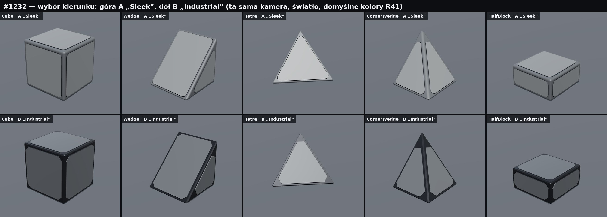
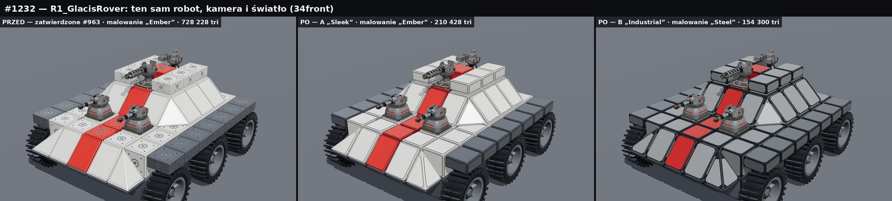
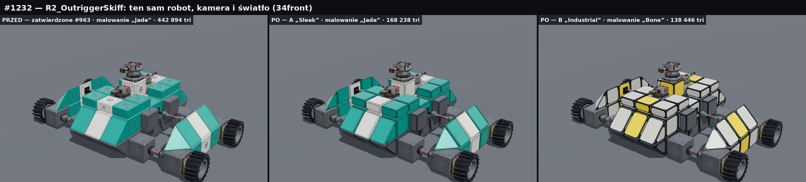

# R4BlocksRedesign1232 — pilot redesignu podstawowych klocków R4 (5 z 30)

Zadanie: [#1232](https://github.com/C8LyNn/RoboRougelike/issues/1232). Biblioteka wyłącznie art. Nie zmienia `Assets/`, scen, prefabów, runtime, fizyki, obrażeń, Save/Load ani ekonomii. Zatwierdzone pliki z PR #963 zostały nietknięte; nowe modele leżą w osobnym katalogu.

**Status: BLENDER_PASS 10/10 · testy zgodności PASS · UNITY_NOT_RUN 10/10 · czeka na wybór kierunku przez właściciela.**

Pilot obejmuje pięć kształtów: `R4B_Cube`, `R4B_Wedge`, `R4B_Tetra`, `R4B_CornerWedge`, `R4B_HalfBlock`. Każdy powstał w dwóch kierunkach stylistycznych. Pozostałych 25 kształtów nie ruszałem — plan jest w [FULL_30_ROLLOUT_PLAN.md](FULL_30_ROLLOUT_PLAN.md).

## Rekomendacja: kierunek A „Sleek”



| | A „Sleek” (rekomendowany) | B „Industrial” |
|---|---|---|
| Krawędzie | zaokrąglone, 20 mm, 4 segmenty, gładkie cieniowanie | twarda faza 10 mm |
| Płyty | zaokrąglone narożniki, wąska ramka | ścięte narożniki, szeroka ciemna rama |
| Kolor | cała bryła malowana: płyta = kolor główny, ramka = jego ciemniejszy ton | neutralne płyty R41 na ciemnej ramie, kolor tylko jako akcent |
| Cube: trójkąty | 684 (LOD1 44) | 236 (LOD1 44) |
| Zatwierdzony Cube | 5 036 | 5 036 |

Dlaczego A:
- Na całym robocie kadłub czyta się jako jedna pomalowana bryła z cienkimi liniami podziału. W B ciemna rama tworzy mocną kratę, która przy 100+ klockach dominuje nad sylwetką (`compare/R1_GlacisRover_paint_34front_before_A_B.jpg`).
- W skali rozgrywki i w miniaturze 256 px A zachowuje czytelne płaszczyzny koloru, a B zlewa się w ciemną siatkę (`compare/R1_GlacisRover_gameplay_scale_before_A_B.jpg`).
- A jest bliżej tego, o co prosi #1232: czytelny, kolorowy, modułowy styl. B lepiej pasuje do samych broni R41, więc zostaje jako alternatywa.

B wygrywa budżetem trójkątów i spójnością z ciemną paletą broni. Jeśli wybierzesz B, zalecam zwężenie ramy, żeby krata była słabsza.

## Co się zmieniło w wyglądzie

- Zniknął wzór portu (pierścień, gniazdo, 4 otwory) i ramka szwu z każdej widocznej ściany. Port jest dalej opisany tymi samymi pustymi obiektami `Port_*` i danymi w QA, ale nie jest już rysowany na pancerzu.
- Każda ściana ma jedną czystą płytę leżącą dokładnie na płaszczyźnie styku ±0,26 m. Rama wokół niej jest cofnięta o 4–5 mm.
- Trzy strefy malowania jako osobne materiały: `R4P_Base` (płyty), `R4P_Secondary` (rama i krawędzie), `R4P_Trim` (wąski uskok płyty). Domyślne kolory to wartości z zablokowanej palety R41. Strefy emisyjnej nie dodałem, bo żaden z pięciu kształtów jej nie potrzebuje.
- Nie dodałem śrub, linii ani drobnych detali. Liczba trójkątów spadła 7–20 razy.

## Roboty przed / po

Ten sam układ, kamera i światło; zmieniają się tylko klocki. Bronie, koła i łączniki to prawdziwe pliki GLB z PR #939, #1018 i #1186.

**R1 „Glacis Rover”** — 136 klocków pilota (79 Cube, 24 Wedge, 21 HalfBlock, 8 CornerWedge, 4 Tetra), 4 bronie, 6 kół:



**R2 „Outrigger Skiff”** — 73 klocki, 6 łączników ROD/STRUT (wysięgniki kół i pancerz dystansowy), 3 bronie, 4 koła:



Pozostałe plansze w `compare/`:
- `*_form_*` — te same roboty w domyślnych materiałach R41, bez malowania (sama zmiana formy);
- `*_paint_*`, `*_paint2_*` — z przykładowym malowaniem, widoki 3/4 przód, bok, 3/4 tył;
- `*_gameplay_scale_*` — kadr 1280×720 bez nadpróbkowania i miniatura 256×144 px;
- `R1_GlacisRover_gameplay_LOD0_vs_LOD1.jpg` — LOD0 i LOD1 w skali rozgrywki;
- `R1_closeup_panel_continuity_*`, `tiling_wall_*` — zbliżenie i ściana powtarzalności;
- `blocks_before_after_3x5.jpg` — każdy klocek przed / A / B.

Układy robotów: `robots/*_layout.json` (komórka, obrót 3×3, model, strefa malowania).

Malowania („Ember”, „Cobalt”, „Jade”, „Steel”, „Bone”) to propozycje do podglądu. W zatwierdzonych klockach do porównania pomalowałem jedyny materiał korpusu (`Armor_Gunmetal`), żeby porównanie było uczciwe.

## Zgodność techniczna — bez zmian względem PR #963

Każda bryła powstaje z tych samych punktów narożnych co w `R4Blocks/scripts/build_blocks.py` (PR #963 @03af520). Generator tylko cofa ramę do wnętrza tej bryły.

| Element | Wartość | Jak sprawdzone |
|---|---|---|
| Siatka / klocek / ściana | 0,55 m / 0,52 m / ±0,26 m | S2: geometria nie wychodzi poza zatwierdzoną bryłę ani jej kolider (0,0 mm) |
| Root, pivot, osie | środek komórki, +Y góra | S1: puste obiekty identyczne z zatwierdzonym GLB (0,0 mm, 0,0°) |
| `Port_*`, `Socket_Mount` | te same nazwy, pozycje, osie | S1 + reimport FBX i GLB w Blenderze |
| `ContactMask`, `cells`, łaty portów | skopiowane z zatwierdzonego QA | S4: 24 obroty, maska kanoniczna zgodna |
| Styk portów | pełny ≥ 80%, częściowy ≥ 65% płasko, nic nie wystaje | S3: ten sam `patch_test` co w #963 |
| Kolizje | bez nowych koliderów | używać zatwierdzonych `R4Blocks/R4B_*/R4B_*_colliders.glb` |

Wyniki: [tests/COMPAT_SUMMARY.md](tests/COMPAT_SUMMARY.md), pełne dane w `tests/compat_report.json`.

- **Macierz modułów (S5):** 51 prawdziwych modułów (8 broni, 11 modułów ruchu, 12 kół, 20 łączników) × 10 pełnych portów × 4 obroty = 2 040 montaży na wariant. Błędy styku: 0. Zablokowane obroty: 0. Regresje względem zatwierdzonych klocków: 0.
- **Roboty (S6):** R1 — 311 par portów, jeden spójny graf, 0 przenikań. R2 — 149 par portów, jeden spójny graf, 0 przenikań. Wyniki identyczne dla zatwierdzonych klocków, A i B.
- **Blender 5.3.0 (każdy model):** manifold, spójne normalne, brak zdegenerowanych ścian, UV; eksport FBX i GLB z ponownym importem (odchyłka obrysu 0,0 mm, komplet pustych obiektów, 3 materiały). Wyniki w `*/R4B_*/R4B_*_QA.json`.

Testy S1–S7 działają na wyeksportowanych plikach GLB, poza Blenderem (`scripts/tests_compat.py`). Macierz S5 sprawdza pozycję spoczynkową modułów; pełnego przebiegu animacji nie powtarzałem, bo S2 dowodzi, że nowe klocki mieszczą się w całości w zatwierdzonej bryle.

## Budżet

| Klocek | Zatwierdzony | A LOD0 / LOD1 | B LOD0 / LOD1 |
|---|---|---|---|
| Cube | 5 036 | 684 / 44 | 236 / 44 |
| Wedge | 3 252 | 512 / 32 | 176 / 32 |
| Tetra | 2 306 | 340 / 20 | 116 / 20 |
| CornerWedge | 2 416 | 454 / 30 | 158 / 30 |
| HalfBlock | 4 716 | 684 / 44 | 236 / 44 |

Klocki robota R1 (136 szt.): 603 480 tri w zatwierdzonych, 85 680 w A, 29 552 w B, 5 488 w A LOD1. Każdy klocek ma 3 materiały; LOD1 ma 2.

## Pliki

```
A_Sleek/R4B_<Kształt>/        R4B_*.blend · .fbx · .glb · _LOD1.fbx · _LOD1.glb · _QA.json · _model_manifest.json · renders/
B_Industrial/R4B_<Kształt>/   to samo dla kierunku B
compare/                      plansze przed/po (klocki, roboty, skala rozgrywki, zbliżenia)
robots/                       układy dwóch robotów testowych
tests/                        COMPAT_SUMMARY.md, compat_report.json
preview/BLOCKS_1232_PREVIEW.zip   podgląd offline z prawdziwymi GLB
mesh_source/                  siatki źródłowe z generatora (wejście dla Blendera)
scripts/                      generator, build w Blenderze, testy, rendery, podgląd
INDEX.json · SHA256SUMS.txt   dane maszynowe i sumy kontrolne wszystkich plików
```

## Podgląd

Rozpakuj `preview/BLOCKS_1232_PREVIEW.zip` i otwórz `index.html`. Internet i serwer nie są potrzebne. Podgląd ładuje 34 prawdziwe pliki GLB osadzone w `models.js` (lista z SHA-256: `preview/embedded_models.json`). Można przełączać scenę (R1, R2, 5 klocków, ściana), wariant (PRZED / A / B), malowanie, LOD1 i siatkę.

## Jak odtworzyć

```
python3 scripts/gen_mesh_source.py                      # numpy + scipy: mesh_source/*.json
blender -b --factory-startup --python scripts/build_blender.py -- <OUT> <REF> mesh_source   # .blend/.fbx/.glb + QA
R4_REF=<REF> python3 scripts/tests_compat.py            # S1–S7
R4_REF=<REF> python3 scripts/render_previews.py         # plansze compare/
R4_REF=<REF> python3 scripts/build_viewer.py            # preview/
python3 scripts/make_manifests.py                       # manifesty, INDEX, SHA256SUMS
```

`<REF>` to katalog z płytkimi kopiami gałęzi `blocks`, `weapons`, `movement`, `wheels`, `connectors` (commity w `scripts/paths.py`).

## Ograniczenia i ryzyka

- **UNITY_NOT_RUN.** Importu do Unity, materiałów URP i zachowania LOD w silniku nie testowałem.
- **Rendery robotów to zrzuty z podglądu three.js**, nie z Blendera ani z Unity. Rendery pojedynczych klocków w `*/renders/` i `compare/before/` pochodzą z Blendera (EEVEE).
- **Szczelina 30 mm między klockami zostaje.** Wynika z kontraktu 0,52 m w komórce 0,55 m. Nie wypełniałem jej, bo każda geometria w szczelinie łamie test styku portów.
- **Nazwy materiałów.** Nowe klocki używają `R4P_Base`, `R4P_Secondary`, `R4P_Trim` zamiast nazw R41. Integracja musi je zmapować na materiały URP; wartości domyślne są z palety R41.
- **UV** to rzut płaski na ścianę (1 jednostka = 1 m), z nakładaniem się wysp. Nadaje się do kafelkowanych detali, nie do unikalnego wypalania.
- **Blender 5.3.0** zamiast 5.2.3 z wcześniejszych PR-ów (taka wersja była na maszynie).
- **Do sprawdzenia w Unity: strona „left/right”.** Zatwierdzone dane #963 opisują Blender +X jako „right”. Importer FBX Unity zwykle odwraca oś X, więc dla kształtów niesymetrycznych (Tetra, CornerWedge) bity left/right w `ContactMask` mogą wypaść lustrzanie. Niczego tu nie zmieniałem — pilot ma dokładnie te same dane co #963 — ale warto to potwierdzić przy pierwszym imporcie.
- Pilot nie zawiera nowych koliderów ani zmian w 25 pozostałych kształtach i 20 łącznikach.
