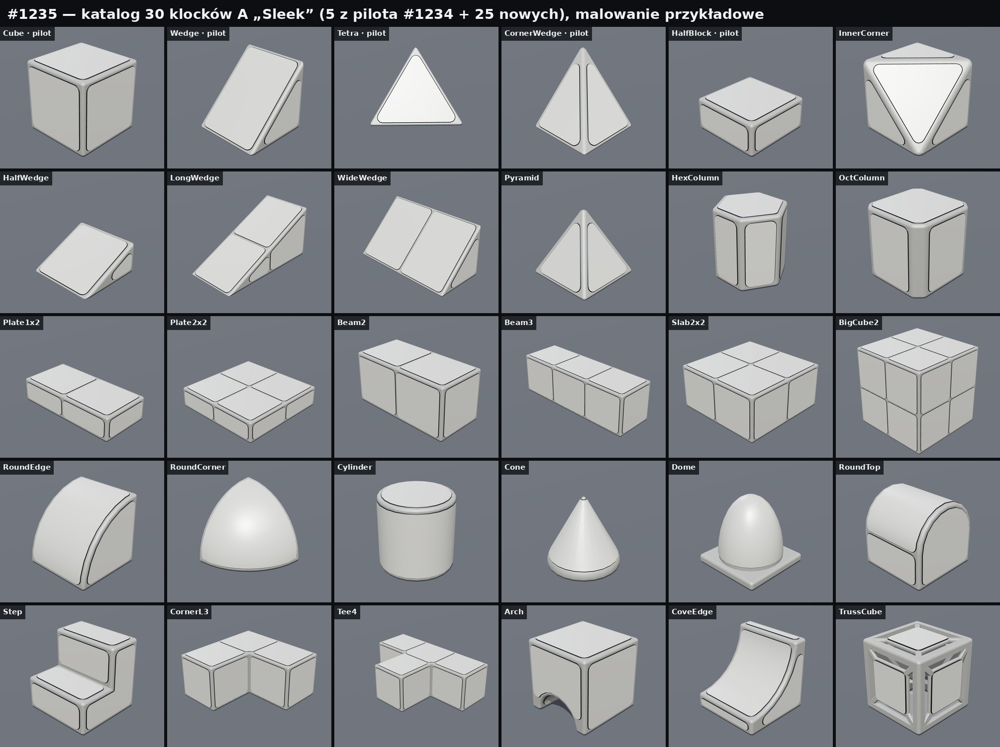
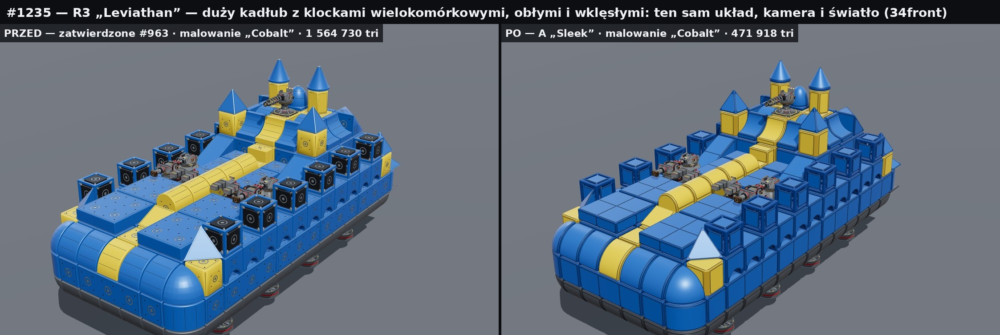
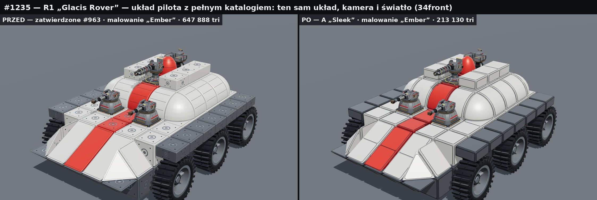
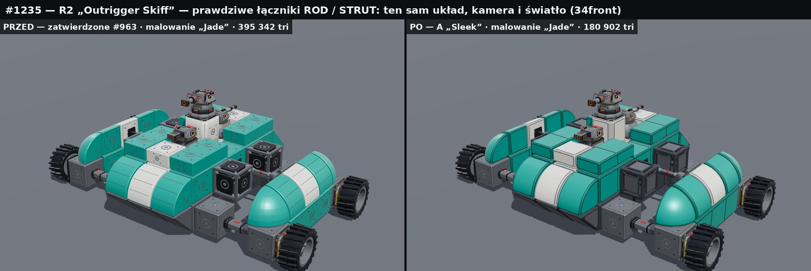

# R4BlocksSleek1235 — pozostałe 25 klocków R4 w stylu A „Sleek” (katalog 30/30)

Zadanie: [#1235](https://github.com/C8LyNn/RoboRougelike/issues/1235). Kontynuacja pilota [#1234](https://github.com/C8LyNn/RoboRougelike/pull/1234) (zadanie #1232). Biblioteka wyłącznie art: nic tutaj nie jest zainstalowane w grze. Nie zmienia `Assets/`, kodu, scen, prefabów, zapisu, kolizji ani ekonomii.

**Status: BLENDER_PASS 25/25 · testy źródłowe S1–S7 PASS (30/30 klocków, 3 roboty) · UNITY_NOT_RUN · WINDOWS_PLAYER_NOT_RUN · czeka na przegląd właściciela.**

Pięć klocków pilota (Cube, Wedge, Tetra, CornerWedge, HalfBlock) nie zostało zbudowanych ponownie. Katalog odwołuje się do nich w `Tools/ModelFactory/R4BlocksRedesign1232/A_Sleek/` (commit `5f4470d`); ten katalog i wariant B „Industrial” są nietknięte.



## Cztery fale

| Fala | Klocki | Blender | Testy źródłowe | Tri zatwierdzone → A (LOD1) |
|---|---|---|---|---|
| 1 — wypukłe / proste | InnerCorner, HalfWedge, LongWedge, WideWedge, Pyramid, HexColumn, OctColumn, Plate1x2, Plate2x2, Beam2, Beam3, Slab2x2, BigCube2 | 13/13 PASS | PASS | 86 784 → 15 162 (600) |
| 2 — obłe | RoundEdge, RoundCorner, Cylinder, Cone, Dome, RoundTop | 6/6 PASS | PASS | 18 572 → 6 806 (564) |
| 3 — wklęsłe | Step, CornerL3, Tee4 | 3/3 PASS | PASS | 31 872 → 5 540 (212) |
| 4 — tunel, łuk wklęsły, kratownica | Arch, CoveEdge, TrussCube | 3/3 PASS | PASS | 15 048 → 5 850 (748) |

Fale były budowane po kolei; każda startowała dopiero po przejściu poprzedniej. Dowody: [WAVE_EVIDENCE.md](WAVE_EVIDENCE.md), `tests/build_logs/`. Pierwsze przebiegi ujawniły cztery błędy (LongWedge, OctColumn, orientacja `Socket_Mount`, obłe bryły wychodzące poza zatwierdzony kolider); zostały poprawione przed ostatecznym, czystym przebiegiem czterech bramek.

## Jak zbudowane są nowe kształty

Język wizualny jest ten sam co w pilocie: rama cofnięta o 4 mm, zaokrąglone krawędzie stałej szerokości 20 mm, jedna płyta na ścianę leżąca dokładnie na płaszczyźnie styku, trzy strefy malowania jako osobne materiały (`R4P_Base`, `R4P_Secondary`, `R4P_Trim`).

- **Klocki wielokomórkowe** (Beam, Plate, Slab, BigCube, LongWedge, WideWedge, CornerL3, Tee4) to nadal jedna część i jeden identyfikator. Dostają jedną płytę na komórkę logiczną z płytką szczeliną 12 mm, więc belka ma ten sam rytm co rząd sześcianów.
- **Kliny ostre** (HalfWedge, LongWedge): zaokrąglenie nosa wynosi 4–5 mm zamiast 20 mm, nos zostaje ostry.
- **Obłe**: jedna płyta owinięta wokół krzywizny, gładkie normalne. Walec i stożek mają płytę-pierścień, kopuła ma kołnierz i gładką czaszę, RoundCorner ma sferyczną płytę trójkątną.
- **Wklęsłe** (Step, CornerL3, Tee4): jedna ciągła powłoka bez ścian wewnętrznych. Płyty przy wklęsłym narożniku mają wycięcie, które go omija.
- **Arch**: prawdziwy tunel z płytą na sklepieniu; stopy są za wąskie na płytę i zostają ramą.
- **CoveEdge**: wklęsła płyta na łuku; ścianki łuku są styczne do zatwierdzonego promienia, więc nic nie wchodzi w pustą przestrzeń.
- **TrussCube**: otwarta kratownica. Rama jest jedną powłoką z sześcioma oknami, a każda ściana ma płytę portu na krzyżaku. Nie ma zaślepionych okien.

Źródło jest odtwarzalne: `scripts/shapes25.py` opisuje 25 brył wymiarami z zatwierdzonego `build_blocks.py`, generatory zapisują siatki do `mesh_source/*.json`, a `scripts/build_blender25.py` robi z nich `.blend`, `.fbx`, `.glb`, LOD1, rendery i QA.

## Roboty przed / po

Ten sam układ, kamera, światło i kolory; zmieniają się tylko klocki. Bronie, koła, moduły ruchu i łączniki to prawdziwe modele z #939, #1018, #941 i #1186.

**R3 „Leviathan”** — 210 klocków (413 komórek, wszystkie 30 rodzajów), 8 silników hover, 2 dopalacze, 7 broni:



**R1 „Glacis Rover”** — układ pilota przebudowany z pełnego katalogu: 88 klocków (146 komórek), 6 kół, 4 bronie:



**R2 „Outrigger Skiff”** — 47 klocków, 6 prawdziwych łączników ROD/STRUT, 4 koła, 3 bronie:



Pozostałe plansze w `compare/`:
- `wave{1..4}_blocks_before_after.jpg` — każdy nowy klocek obok zatwierdzonego;
- `*_paint_{34front,side,34rear}_before_A.jpg`, `*_form_34front_before_A.jpg` — roboty z malowaniem i w domyślnych materiałach R41;
- `*_garage_close_before_A.jpg` — zbliżenie garażowe;
- `*_gameplay_scale_before_A_LOD1.jpg` — 1280×720 bez nadpróbkowania i miniatura 256×144 px, także z LOD1.

Układy: `robots/*_layout.json`.

## Zgodność — bez zmian względem PR #963

Interfejs każdego klocka (komórki, porty, `Socket_Mount`, `ContactMask`, wiązania komórek) jest czytany z zatwierdzonego QA i zatwierdzonego GLB. Generator go nie definiuje.

| Test | Zakres | Wynik |
|---|---|---|
| S1 interfejs | puste obiekty 30 klocków względem zatwierdzonego GLB, pełna orientacja | PASS, 0,0 mm |
| S2 bryła | wierzchołki, środki krawędzi i ścian LOD0 i LOD1 wewnątrz zatwierdzonej bryły i komórek; odległość poza zatwierdzonym koliderem nie większa niż dla zatwierdzonego modelu | PASS |
| S3 styk portów | zatwierdzony `patch_test` na każdym porcie, LOD0 i LOD1 | PASS |
| S4 obroty | 24 obroty, ściany lokalne i światowe, `ContactMask` | PASS |
| S5 moduły | 51 prawdziwych modułów × 137 pełnych portów × 4 obroty = 27 948 montaży na wariant | 0 błędów styku, 0 regresji |
| S6 roboty | konflikty komórek, graf portów, przenikanie modułów | 3/3 PASS, 1 spójny graf, 0 przenikań |
| S7 budżet | trójkąty, renderery, sloty materiałów | raport |

Pełne wyniki: [tests/COMPAT_SUMMARY.md](tests/COMPAT_SUMMARY.md), `tests/compat_report.json`.

W macierzy S5 jest 342 zablokowanych obrotów i 30 portów zablokowanych całkowicie, identycznie dla zatwierdzonych klocków i dla A. Liczone są wobec wypukłych brył, więc dla klocków wklęsłych wynik jest ostrożny.

## Budżet

Każdy klocek to 1 renderer i 3 sloty materiałów (LOD1: najwyżej 3).

| | Zatwierdzone #963 | A LOD0 | A LOD1 |
|---|---|---|---|
| Katalog 30 klocków | 170 002 | 36 032 | 2 294 |
| Klocki robota R1 (88) | 523 140 | 88 382 | 3 966 |
| Klocki robota R2 (47) | 272 564 | 58 124 | 4 236 |
| Klocki robota R3 (210) | 1 386 972 | 294 160 | 18 798 |

Liczby per klocek są w `tests/COMPAT_SUMMARY.md` i w `INDEX.json`. To dane źródłowe plików, nie pomiar FPS.

## Pliki

```
A_Sleek/R4B_<Kształt>/     25 nowych: .blend · .fbx · .glb · _LOD1.fbx · _LOD1.glb · _QA.json · _model_manifest.json · renders/
compare/                   plansze przed/po, katalog, roboty, zbliżenia, skala rozgrywki
robots/                    układy trzech robotów
tests/                     COMPAT_SUMMARY.md, compat_report.json, build_logs/
preview/R4_SLEEK_30_PREVIEW.zip   podgląd offline z prawdziwymi GLB
mesh_source/               siatki z generatora (wejście dla Blendera)
scripts/                   generatory, build, testy, rendery, podgląd, manifesty
INDEX.json                 katalog 30 klocków (25 tutaj + 5 pilota przez odwołanie)
WAVE_EVIDENCE.md           dowody per fala
CONNECTOR_A_STYLE_PLAN.md  propozycja stylu A dla 20 łączników (nie wykonana)
CHANGED_FILES.txt · SHA256SUMS.txt
```

## Podgląd

Rozpakuj `preview/R4_SLEEK_30_PREVIEW.zip` i otwórz `index.html`; internet i serwer nie są potrzebne. Każdy plik GLB jest osadzony raz (101 plików, lista z SHA-256 w `preview/embedded_models.json`). Sceny: trzy roboty, katalog 30 klocków oraz pojedynczy klocek z zatwierdzonym modelem obok A. Przełączniki: PRZED / A, malowanie, LOD1, siatka.

## Jak odtworzyć

```
python3 scripts/gen_mesh_source25.py                    # numpy + scipy (+ scikit-image dla wklęsłych pokryw): mesh_source/*.json
python3 scripts/precheck.py                             # szybka kontrola generatora bez Blendera
blender -b --factory-startup --python scripts/build_blender25.py -- <OUT> <REF> mesh_source [Kształt,...]
R4_REF=<REF> python3 scripts/tests_compat25.py          # S1–S7
R4_REF=<REF> python3 scripts/render25.py blocks catalog robot:R3_Leviathan garage:R3_Leviathan game:R3_Leviathan
R4_REF=<REF> python3 scripts/build_viewer25.py
R4_REF=<REF> python3 scripts/make_manifests25.py
```

Wersje: Blender 5.3.0, Python 3.13, numpy, scipy 1.18, scikit-image 0.26, three.js r128. `<REF>` to płytkie kopie gałęzi z commitami zapisanymi w `scripts/paths.py` pilota. Skrypty importują generator pilota z `R4BlocksRedesign1232/scripts/` i go nie modyfikują.

## Ograniczenia i otwarte punkty

- **UNITY_NOT_RUN, WINDOWS_PLAYER_NOT_RUN.** Import, materiały URP, LOD Group i wydajność w silniku nie były sprawdzane.
- **Plansze robotów to zrzuty z podglądu three.js** na prawdziwych GLB. Z Blendera pochodzą rendery pojedynczych klocków w `A_Sleek/*/renders/` i `compare/before/`.
- **RoundCorner ma promień 515 mm zamiast 520 mm.** Zatwierdzona bryła jest wielościanem 9×9, a jego kolider jest o 5 mm ciaśniejszy od idealnej sfery. Gładka sfera o pełnym promieniu wychodziłaby poza kolider, więc ją zmniejszyłem. Obok RoundEdge (pełny promień) daje to uskok 5 mm.
- **Stożek jest o 21 mm niższy** od zatwierdzonego czubka, bo ma zaokrąglony wierzchołek. Kopuła ma podstawę o średnicy 456 mm zamiast 496 mm, żeby zmieścić zaokrągloną krawędź płyty bazowej.
- **TrussCube LOD1** zastępuje krzyżaki prostymi belkami (536 tri); to najcięższy LOD1 w katalogu.
- **Zatwierdzone modele Cylinder, Cone, Dome i Arch same wystają poza własne kolidery** (7–50 mm). Wersje A wystają mniej, ale nie zero; liczby są w `tests/COMPAT_SUMMARY.md`.
- **Szczelina 30 mm** między częściami zostaje, bo wynika z kontraktu siatki.
- **UV** to rzut płaski lub rozwinięcie powierzchni w metrach, z nakładaniem się wysp. Nadaje się do kafelkowanych detali, nie do unikalnego wypalania.
- **Strona left/right** dla kształtów niesymetrycznych nadal wymaga potwierdzenia przy pierwszym imporcie do Unity (opis w README pilota). Dane są identyczne z #963.
- Bez nowych koliderów. 20 łączników z #1186 nie zostało przerobionych; jest tylko plan.
